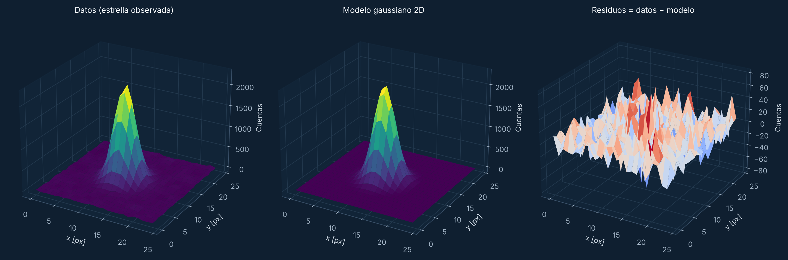
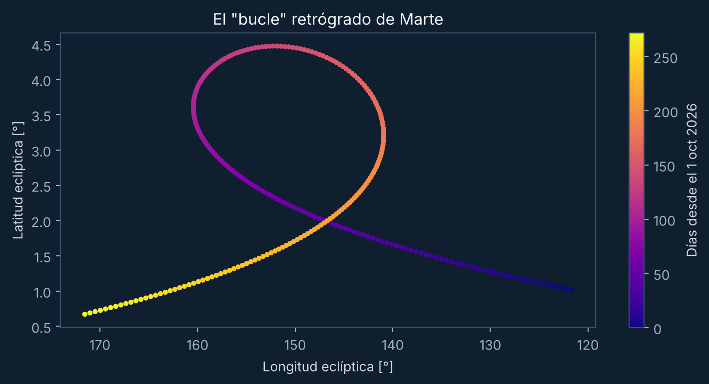
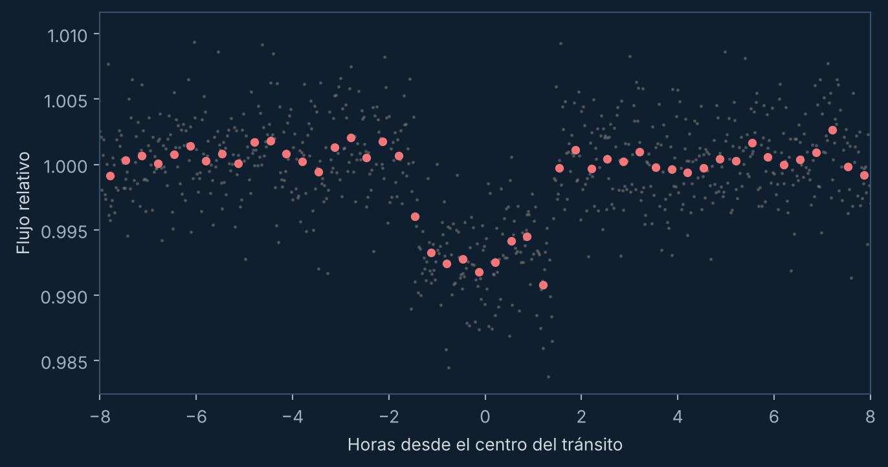

::: {.hero}
[Astronomía computacional con Python]{.hero-kicker}

[Aprende Astropy desde cero]{.hero-title}

[Del primer `import` a un pipeline de reducción de datos: 17 módulos prácticos, con código comentado línea a línea y ejemplos que puedes ejecutar en tu computador.]{.hero-lead}

[Empezar por el módulo 01](posts/basico/01-introduccion.qmd){.btn .btn-primary .btn-lg}
[Ver los módulos](#niveles){.btn .btn-outline-secondary .btn-lg}
:::

::: {.seccion-home #niveles}
[Ruta de aprendizaje]{.seccion-kicker}

::: {.niveles}
::: {.nivel-card .nivel-basico}
[Nivel 1 · 5 módulos]{.nivel-tag}

**Básico**

Unidades, tiempo, coordenadas y tablas: el idioma de Astropy antes de tocar datos reales.

[Empezar →](posts/basico/01-introduccion.qmd)
:::

::: {.nivel-card .nivel-inter}
[Nivel 2 · 6 módulos]{.nivel-tag}

**Intermedio**

Imágenes FITS, WCS, fotometría, visualización, estadística y catálogos en línea.

[Empezar →](posts/intermedio/06-fits.qmd)
:::

::: {.nivel-card .nivel-avanzado}
[Nivel 3 · 6 módulos]{.nivel-tag}

**Avanzado**

Espectroscopía, cosmología, órbitas, exoplanetas y un pipeline completo de reducción.

[Empezar →](posts/avanzado/12-espectroscopia.qmd)
:::
:::
:::

::: {.seccion-home}
[Lo que vas a construir]{.seccion-kicker}

::: {.destacados}
::: {.destacado}

**Una estrella en 3D** · modelo y residuos de su luz · [Módulo 08](posts/intermedio/08-fotometria.qmd)
:::

::: {.destacado}

**El bucle de Marte** · movimiento retrógrado real · [Módulo 14](posts/avanzado/14-orbital.qmd)
:::

::: {.destacado}

**Un exoplaneta** · detectado por su tránsito · [Módulo 15](posts/avanzado/15-series-temporales.qmd)
:::
:::
:::
